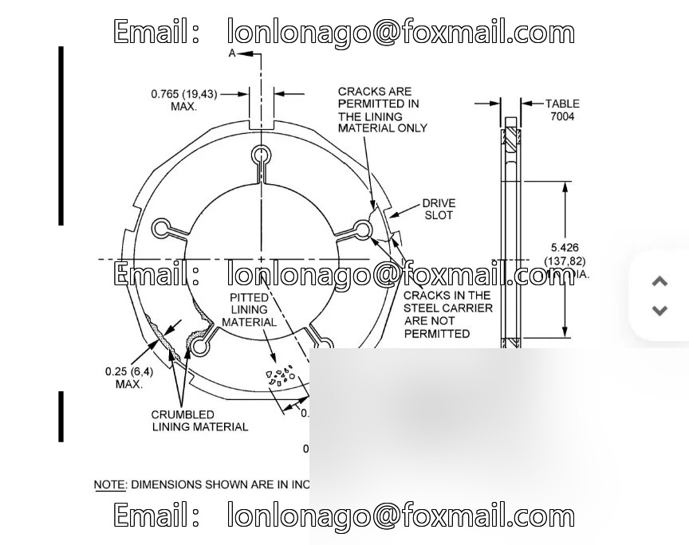
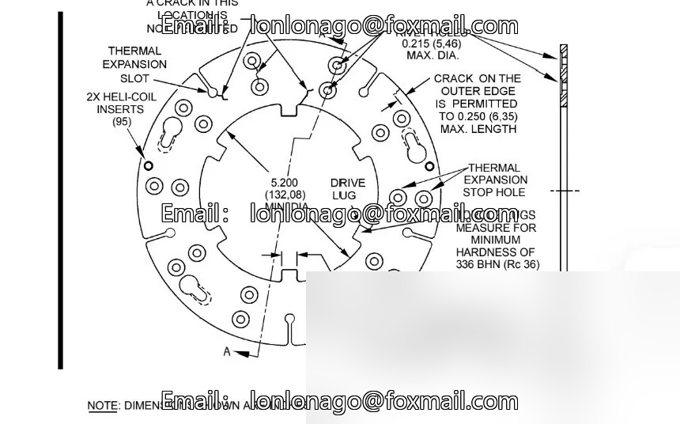
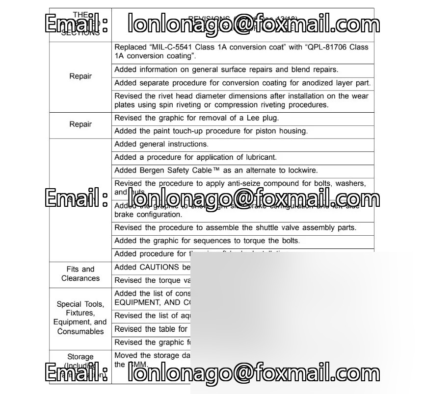

# Main Landing Gear Brake Component

## Body

Main Landing Gear Brake Assembly
Maintenance manuals and illustrated part lists published by UTC Aerospace Systems (UTC Aerospace Systems Joint Technology Aerospace Systems Company), PDF , 240 pages.
816567448

This material is released by UTC Aerospace Systems, includes maintenance manuals, illustrated part lists and a PDF with 240 pages, also numbered 816567448.

<!-- AI_ENRICHED -->

## Images

## Payment

Here is a pay link on Stripe ( https://buy.stripe.com/3cs8yP7sY87d0vu9AB ). Please contact me lonlonago@foxmail.com after funding $89, and I will send you a complete data files , thank you!

